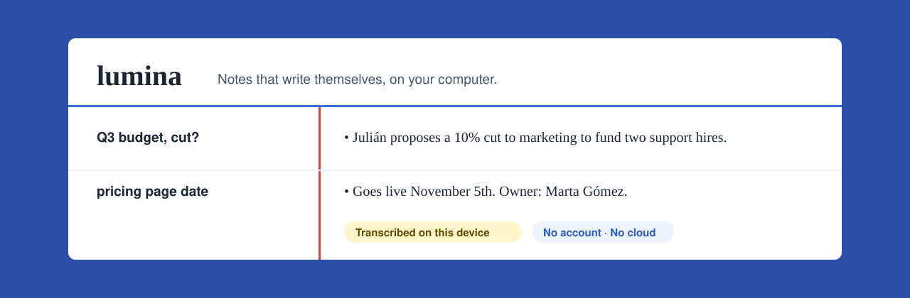
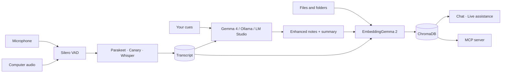

<p align="center">
  
</p>

<p align="center">
  <b>Lumina listens to your meetings and classes, writes the notes you meant to take, and answers questions from your own files.<br>
  Everything runs on your computer. No account, no cloud.</b>
</p>

<p align="center">
  <a href="https://lautaro005.github.io/lumina/">Website</a> ·
  <a href="https://lautaro005.github.io/lumina/docs/">Docs</a> ·
  <a href="CHANGELOG.md">Changelog</a> ·
  <a href="SECURITY.md">Security</a>
  <br><br>
  
  
  
  
</p>

---

## Install

**macOS or Linux** — open Terminal and paste:

```bash
curl -fsSL https://lautaro005.github.io/lumina/install.sh | sh
```

**Windows** — open PowerShell and paste:

```powershell
irm https://lautaro005.github.io/lumina/install.ps1 | iex
```

Then type **`lumina`** to open it in your browser, or **`lumina app`** for the desktop app. The first time, Lumina asks
what language your meetings are in and which model should write your notes, and downloads what it needs (about 1.5 GB
plus the notes model). After that it works offline.

> [!NOTE]
> Lumina 0.1 installers are not signed by Apple or Microsoft yet. macOS may ask you to confirm the first launch; Windows
> SmartScreen may show a warning.

## What it does

| | |
|---|---|
| 🎙️ **Listens** | Records your microphone (**You**) and your computer's audio (**Others**: Zoom, Meet, Teams…) and transcribes both live, on the CPU. |
| ✍️ **Writes your notes** | You type short cues while you listen. Lumina writes the full note for each one and adds the points you missed. Three views: side by side, Cornell rows, or one at a time. |
| 🔄 **Updates itself** | Lumina looks for new versions and updates from a button inside the app (Settings → About), keeping your data. |
| 📋 **Sums it up** | When the meeting ends you get an overview, decisions, action items and open questions, and an automatic title. |
| 💡 **Helps live** | When someone asks a question your documents can answer, a short answer with its source appears beside your notes. |
| 📚 **Knows your files** | Add PDFs, Word, PowerPoint, Excel, Markdown, text, HTML or code, or whole folders it keeps up to date. A progress bar shows the indexing, a folder opens like a dropdown to list its files, and your finished meetings are listed there too. |
| 💬 **Answers questions** | Ask "what did we decide about pricing?" across every meeting and file. Every answer cites its sources. Web search is optional and off by default. |
| 🤖 **Works with your agents** | Claude, Cursor, Codex or any MCP client can search your meetings and files through Lumina's MCP server. |
| 🔊 **Reads aloud** | Notes and answers can be read with a natural voice (Kokoro) or your system voice. |

**Meeting notes views** (Settings → General): **Side by side** (default) puts your shorthand on the left and the live
enhanced notes on the right; **Cornell rows** follows the Cornell note-taking method, your words in the left column and
Lumina's beside each one, with the red margin line coming alive while Lumina listens; **One at a time** gives you a wide
page with a switch. The summary always sits at the foot.

## Private by design

- Audio, transcripts, notes, embeddings and answers never leave your computer.
- The server listens only on `127.0.0.1` and refuses requests from websites and other machines.
- No telemetry, no account, no sign-in.
- Only a few things ever touch the internet: downloading models, web search (if you turn it on), a model server you
  point Lumina at yourself, and a version check against this repository (switch it off in Settings → About).

## Models

Lumina picks small, open models that run on an ordinary laptop. Each shows its size, license and memory needs before it
downloads.

| Job | Model | Size | Why |
|---|---|---|---|
| Transcription (default) | **Parakeet TDT 0.6B v3** (NVIDIA, 8-bit) | 670 MB | Very fast on any CPU, 25 European languages including English and Spanish, detects the language by itself. |
| Transcription, fixed language | **Canary 1B v2** (NVIDIA, 8-bit) | 1.0 GB | Same 25 languages, but follows the language you choose, so it never guesses wrong. |
| Transcription, any language | **Whisper** tiny → large-v3-turbo | 75 MB – 1.6 GB | 99 languages; `tiny` for very small machines. |
| Transcription, experimental | **EmbeddingGemma 2 speech** (community reader on EmbeddingGemma 2's audio encoder) | 980 MB | English only, about 4 % WER on read speech, no punctuation, CPU through `ai-edge-litert`. Opt-in; "Automatic" never picks it. |
| Speech detection | **Silero VAD** | 2 MB | Knows when someone is speaking. |
| Search | **EmbeddingGemma 2** (Google, 8-bit) | 350 MB | The same embedding model Google Foresight uses, 100+ languages. |
| Notes and answers | **Gemma 4 E2B / E4B / 12B** (Google, 4-bit) | 2.8 / 4.6 / 7.2 GB | Choose by how much memory you have. Or use **Ollama** or **LM Studio** instead. |
| Read aloud (optional) | **Kokoro 82M** | 120 MB | Natural voices in 8 languages. |

**Transcription language.** Settings → Transcription has **Automatic** and the full list of languages the chosen model
supports. If you know the language, choose it: automatic detection can guess wrong on short or mixed audio. With the
default "Automatic" model setting, Lumina uses Parakeet for automatic detection, Canary when you pick a European language,
and Whisper for any other language.

**Live transcript in the notch** (desktop app, Settings → Transcription): while you record, a black island grows out of the notch (or the top edge of the screen) with the last three lines of the transcript. Click it to return to the meeting.

**Delete data** (Settings → Delete data): delete all chats, all sources, all meetings or everything, passages included. Settings and models stay.

Settings → Models lists everything grouped by what it does: chat and notes, transcription, embeddings and read aloud, and a **Running now** panel with a Stop button to free the memory of the local model whenever you want.

**Already use Ollama or LM Studio?** Lumina finds them on their usual ports and lists their models. Any other
OpenAI-compatible server works too.

## Connect your agents (MCP)

Lumina exposes six tools: `search_knowledge`, `list_sources`, `get_document`, `add_note`, `query_meetings`,
`get_meeting`.

**Claude Code**

```bash
claude mcp add lumina -- lumina mcp
```

**Claude Desktop, Cursor and others** (stdio):

```json
{ "mcpServers": { "lumina": { "command": "lumina", "args": ["mcp"] } } }
```

Clients that connect to a URL can use `http://127.0.0.1:47770/mcp` with the token from Settings → Agents, where you can
also copy these snippets with the full path filled in.

## Commands

| Command | What it does |
|---|---|
| `lumina` | Open Lumina in your browser |
| `lumina app` | Open the desktop app (window + tray icon) |
| `lumina mcp` | MCP server for agents (stdio) |
| `lumina update` | Update to the latest version |
| `lumina doctor` | Check microphones, models and model servers |
| `lumina models` | List models · `lumina models download <id>` |
| `lumina uninstall` | Remove the command and the app (keeps your data) |

Your data lives in `~/.lumina/data` (`%USERPROFILE%\.lumina\data` on Windows).

## How it works



- **Backend:** Python (FastAPI) on `127.0.0.1:47770`, SQLite for meetings, ChromaDB for the vector index,
  onnxruntime for Parakeet, Canary, EmbeddingGemma 2 and Silero, CTranslate2 for Whisper, llama.cpp for Gemma 4.
- **Interface:** React + TypeScript, served by the backend; the same page runs in the browser and in the desktop app.
- **Desktop:** Tauri 2 (Rust), a window and a tray icon that start and stop the local server.
- **System audio:** ScreenCaptureKit on macOS, WASAPI loopback on Windows, the PulseAudio/PipeWire monitor on Linux.

## Build from source

You need [uv](https://docs.astral.sh/uv/), Node.js 22+ and, for the desktop app, Rust.

```bash
git clone https://github.com/Lautaro005/lumina && cd lumina
uv sync
(cd web && npm install && npm run build)   # builds the UI into lumina/ui
uv run lumina                               # opens http://127.0.0.1:47770
```

Desktop app: `cd apps/desktop && npm install && npm run tauri build`. Or let the installer build it:
`curl -fsSL https://lautaro005.github.io/lumina/install.sh | sh -s -- --build-app`.

Tests: `uv run pytest` · `cd apps/desktop/src-tauri && cargo test`.

## FAQ

**Does it need a GPU?** No. Every default runs on the CPU. On Apple Silicon, Gemma 4 uses the GPU automatically.

**How much memory?** Transcription and search fit in about 2 GB. Gemma 4 E2B wants 8 GB of RAM in total, E4B 12 GB,
12B 16 GB. With less, connect a smaller model through Ollama or LM Studio.

**Does it identify who is speaking?** It separates **You** (your microphone) from **Others** (the computer's audio).
Telling apart several people in the same stream is planned.

**Is it a Google product?** No. It is an independent, open alternative to Google AI Edge Foresight that needs no Google
account and runs on macOS, Windows and Linux.

## License

Lumina is **free to use, modify and share, but not to sell**: [Apache-2.0 with the Commons Clause](LICENSE). You may not
sell Lumina or a product or service (including hosting or paid support) whose value comes substantially from it. This makes
it source-available rather than OSI open source.

The models keep their own licenses (Apache-2.0, MIT, CC-BY-4.0), shown in the app before each download.

Security issues: please report them privately as described in [SECURITY.md](SECURITY.md).
